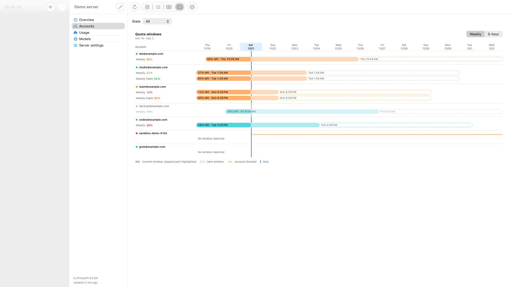
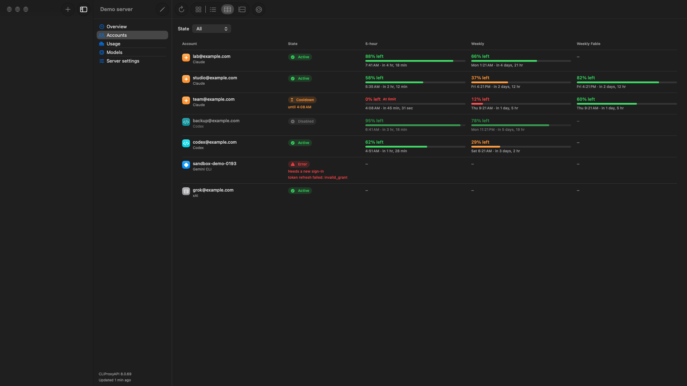
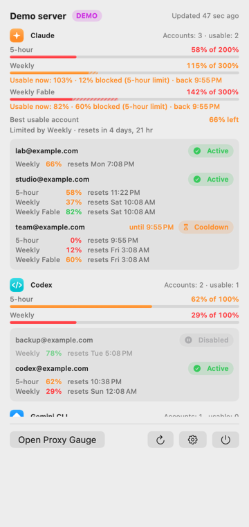
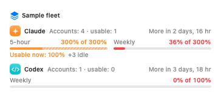
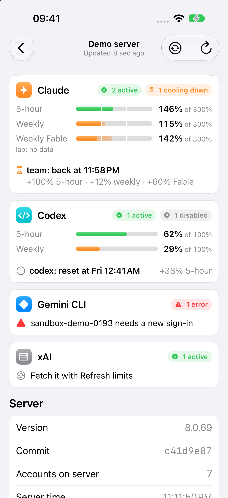
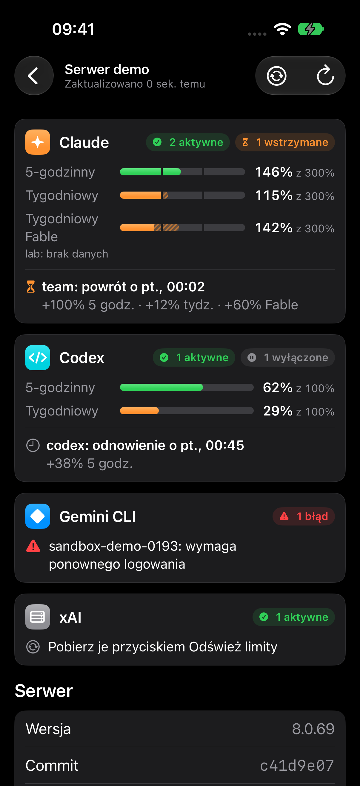
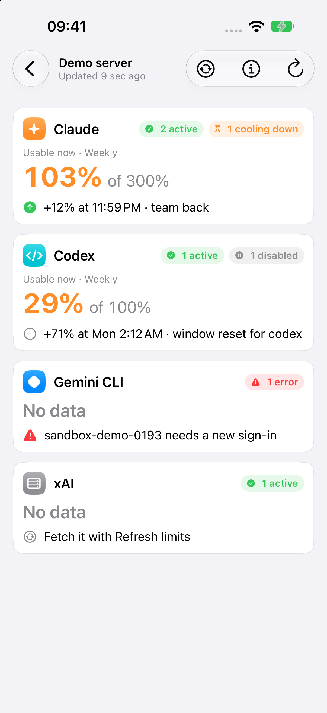
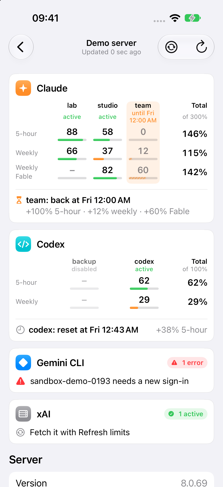

# Proxy Gauge

A native iPhone and Mac app for [CLIProxyAPI](https://github.com/router-for-me/CLIProxyAPI) servers. See how much quota your Claude, Codex and other accounts have left, which accounts are cooling down, and how much traffic the proxy has served, from your phone.

There are several macOS menu-bar apps for CLIProxyAPI. Proxy Gauge exists because there was nothing for the iPhone; the Mac app comes from the same code.

## Screenshots

Built-in demo server and the anonymised sample fleet, Mac:

<p>
  
  
  
  
  
</p>

Built-in demo server, iPhone:

<p>
  
  
  
  
  
</p>

The other two Overview layouts, picked in Settings: Answer first and Accounts strip.

<p>
  
  
</p>

## Status

Internal TestFlight builds; App Store release in preparation. Until then, build it from source (see [Building](#building)).

## Features

- **Several servers**, each with a name, address and either a management key or a client key. The app checks a server when you save it and shows what it found: version, accounts or models, and which optional endpoints answer.
- **Built-in demo server** with realistic sample data (seven accounts across Claude, Codex, Gemini CLI and xAI in every state, plus simulated provider answers for Refresh limits), clearly labelled, so you can try the app without a proxy. You can delete it like any other server and bring it back with "Add demo server" when adding a server.
- **Management key mode**
  - Overview: one card per provider with the number of accounts per state, in one of three layouts picked in Settings ("Overview layout"): **Answer first** (one big number per provider: what is usable now in its tightest window and when it grows next, and who or what brings it back), **Compact rows**, the default (every window as a short bar with the pooled percent, blocked quota hatched, and one line on which account comes back when and how much it adds) and **Accounts strip** (one column per account and one row per window, so you see at once which account is blocked and until when, with the pooled total on the right). On the Mac and other wide windows the accounts board follows below, so up to about eight accounts fit one 1920×1080 screen without scrolling. Server details (version, commit, accounts on the server, server time, the automatic refresh switch and "How these numbers work") sit in a Server section at the bottom, or behind an info button in the toolbar in Answer first.
  - Provider detail: opening a provider card shows its pooled windows (what is left, usable now, blocked and when more comes back), the accounts-by-window grid with totals, the comeback line, the best usable account when it says something the pool does not, and the provider's accounts. The title shows "Accounts: 3 · usable: 2".
  - Accounts: a board in four layouts, picked in the toolbar and remembered on each device: **Cards** (an adaptive grid of compact account cards), **List**, **Table** (one row per account, one column per quota window) and **Timeline** (one row per account, each quota window drawn as a bar from when it opened to when it resets, the next window dashed, a marker at the current time and a hatched strip while the account is blocked, whether by a cooldown, another window at its limit or a needed sign-in; a window whose reset has passed shows "Reset passed"; on a blocked account a "Starts on use" or "Reset passed" window is drawn from the end of the block, or shown as text only when the block has no end; switch between Weekly and 5-hour; VoiceOver reads each account row as one item). Table and Timeline are for the Mac and other wide windows. Each account shows its state (active, cooldown, disabled, error), the plan when the provider reports one, and every quota window as a bar with the remaining percent, the reset time and a countdown; accounts at the limit or cooling down are marked. Opening an account shows its cooldown details, recent request chart, enable/disable and reset cooldown (each with a confirmation).
  - Usage: request totals, failures, a chart of the last 200 minutes, requests per provider, and token totals per model when the server keeps a client-key usage report.
  - Models available across your accounts.
  - Server settings: routing strategy (read and change, protected against concurrent config edits; when the server reports no config version, the app asks once more before an unconditional write), and the number of configured client keys on servers that publish client-key policies. Key values are never read or shown.
- **Refresh limits** (management key only): asks the providers for fresh limits through the server, the way the panel's "Refresh quota" and "Refresh all credentials" do, for all accounts (toolbar of Overview and Accounts) or one account (the card's context menu, or the account page). A confirmation sheet lists what will be contacted first and sends nothing by itself: when the accounts are not loaded yet or the server is paused, it shows a "Load accounts" button and keeps the confirm button off until you press it. The results add the plan, manual resets left and when they expire, extra usage and credits to cards and the account page, and every bar that came from a provider carries a small antenna mark. An optional setting refreshes them automatically while the app is visible. See [Refreshing limits from providers](#refreshing-limits-from-providers).
- **Client key mode**: the models the key may call, and the same provider tiles and accounts board for the credentials, with exclusions, on servers that offer `/v1/fleet/limits`. Stock CLIProxyAPI does not have that endpoint; the app says so plainly.
- **Remaining quota everywhere**: every bar (per account, pooled, headroom, widget, menu bar) shows how much is left and fills with the remaining share, coloured by it (red when little is left), like the CLIProxyAPI web panel.
- **Pull to refresh** and auto refresh of the visible screen while the app is open (default 60 s, configurable). Automatic refresh is a switch per server in Settings ("Refresh automatically", on by default). With it off, nothing refreshes that server on its own: not at launch, not when the app comes back to the foreground, not on the first visit of a section, not when an account is opened and not after a failed load. The Overview (Limits in client-key mode) and the menu bar show the last saved pooled capacity and best account, recomputed for the current time, with their age and the hint "Automatic refresh is off — pull to refresh or press Refresh"; other screens show the hint. Refreshing by hand (pull to refresh, the Refresh button or ⌘R) always works. The switch is enforced in one place, the session's admission check, so every automatic trigger obeys it. Pulling to refresh an account always reloads the account, even while the page is still loading its models, and loads its models only when they are not loaded yet or automatic refresh is on. When the server rejects the key, automatic refresh (app, menu bar and widget) pauses until you refresh by hand, a change to the server succeeds, or you save the server again ("Save anyway" after a rejected check keeps the pause on), so a wrong key never runs into the proxy's ban on repeated failed logins. The app sends at most one management request at a time per server entry: refreshes, changes and provider checks wait for each other in one queue, and each request checks the pause right before it leaves. When the server rejects the key, the pause is recorded the moment that answer arrives, before the next queued request gets its turn, so a rejected key costs one failed attempt and nothing else is sent until you refresh by hand or change something. A change you make while a refresh is still running is not sent if that refresh finds the key rejected; the app asks you to refresh first. When the proxy has already banned this network address (for example after failed logins from another client), the app and the menu bar say so and show when the ban ends, and neither they nor the widget blame the key.
- **iPhone widgets**, both opening the app on that server's Overview (Limits for a client-key server) when tapped (`proxygauge://server/<id>/overview`, from a cold launch or while the app is running):
  - **Headroom** (small, medium): the best single account per provider on your default server, lowest first.
  - **Pooled capacity** (small, medium, large, and the lock screen's rectangular and circular): all accounts of a provider added up, so three Claude accounts show for example "187% of 300%". Small shows the binding window of one provider (the window with the smallest share usable now, the plain sum breaking ties), medium shows 5-hour and weekly for each provider with the account count and when capacity grows next, large shows every window. The lock-screen gauges fill to the part usable now, matching their text. Edit the widget to pick the server (the default server unless you choose one) and the primary provider (the one with the least usable now unless you choose one).
- **Mac**: a split-view window plus a menu bar item with pooled capacity, what is usable now and the best usable account per provider, followed by a compact list of that provider's accounts (label, state, each window's remaining percent and reset time); the list scrolls when it gets tall. Without fresh data the menu bar recomputes both from the last saved accounts at the current time, so a reset that passed since then shows up without a request.
- English and Polish.

### What "headroom" (best account) means

CLIProxyAPI records the rate-limit headers that providers send back with normal responses. Proxy Gauge turns those passive observations into quota bars. For each provider it looks at every account that can currently serve requests (not disabled and not blocked: not cooling down, no account-wide window at the limit, not waiting for a new sign-in; an account in the error state still counts when it does not need one), takes that account's tightest window (the window with the least left, where a window at the limit counts as 0%), and shows the best of those as the provider's headroom: how much the best single account can still do. Windows of different accounts are never mixed, so accounts with (90% left in 5-hour, 10% weekly) and (10% 5-hour, 90% weekly) give 10%, not 90%. The app shows it as the "Best usable account" line on the provider detail, in the provider tiles of client-key mode and in the menu bar when at least two accounts can take requests (with one it would repeat the pooled numbers); the Headroom widget lists it per provider. Missing data is shown as unknown, never as zero. Pooled capacity (below) adds the accounts up instead, so the two answer different questions: "can one more long session fit on one account?" and "how much is left in total?".

### What is left in a window

Every bar, table cell, pooled sum, headroom, widget and menu bar uses one rule for what is left in a window:

1. the window's reset time has passed: 100% (the provider starts a fresh window, like the proxy's `reset_passed`);
2. the window is at the limit (a `rejected` status or 100% used): 0%, even when no usage value was reported;
3. otherwise 100% minus the reported usage;
4. no usage value: unknown, never 100% and never 0%.

### Five-hour window states

Claude and Codex accounts can have a 5-hour window. Proxy Gauge tells these cases apart:

- **Never sampled**: the proxy holds no quota observation for the account. The card says "No quota data reported yet" and pooled capacity lists it under "Accounts without data".
- **No 5-hour window running**: the account reports other windows (for example weekly) but no 5-hour window. The card shows "No 5-hour window running" in a neutral style. While the account can take requests, pooled capacity counts it as a full 5-hour window (100% of capacity and 100% usable), because its next request starts a fresh window, and says "1 account has no 5-hour window running, counted as full". A blocked account without a 5-hour window cannot start one, so it is left out of the 5-hour window, both what is left and the capacity, and listed as "Blocked with no 5-hour window, left out: 1". The menu bar and the large widget show the short note "incl. 1 idle account at 100%" under the 5-hour row, the medium widget adds "+1 idle" to its usable line, and the menu bar's account list shows that account's 5-hour window as "100% starts on use". Either way the account still counts in its other windows.
- **Starts on use**: the proxy reported the 5-hour window with 0% used and no reset time. That is an unused window that starts on the next request, so it counts as full and is labelled "Starts on use, 100% left".
- **Running**: a normal 5-hour window with usage and a reset time.

These states and the "Starts on use" label apply only to Claude and Codex. Other providers that happen to report a 5-hour window (for example a Kimi limit of 300 minutes) are counted like any other window: an account without it is unknown, not "No 5-hour window".

### What "pooled capacity" means

Pooled capacity adds the accounts of a provider together, per window (5-hour, weekly, and the weekly model window where the provider reports one, named after its model, for example "Weekly Fable"). Every account that is not disabled adds 100% of capacity, so three accounts make 300%; a disabled account is left out entirely. The headline is the sum of each account's remaining quota in that window, exactly as the CLIProxyAPI management panel would add up its cards, for example "168% of 300%", with these rules:

- a window at the limit (used 100% or a `rejected` status, with or without a usage value) adds 0% until it resets;
- an account whose window reset time has passed adds 100%, because the provider starts a fresh window (the same rule as the proxy's `reset_passed`); an explicit 0% used with no reset time also adds 100% (the window starts on use);
- an account with no sample for that window is counted as unknown and shown separately, never as 0% or 100%;
- a Claude or Codex account that reports other windows but no 5-hour window counts as a full 5-hour window while it can take requests, and is left out of the 5-hour window while it is blocked (see above).

Part of that sum may not be usable right now. An account is **blocked** while it is in cooldown, while one of its account-wide windows (5-hour, weekly, daily, monthly) is at the limit, or while it waits for a new sign-in; a model window such as Weekly Fable at its limit does not block the account's other windows. A blocked account's remaining quota stays in the headline but is drawn hatched in the bar, and the row adds a line such as "Usable now: 66% · 102% blocked (weekly limit) · 58% back Fri 12:00": how much of the blocked quota comes back first and when. When every blocked account comes back at the same time the line ends in "· back Fri 12:00"; for a sign-in or a cooldown without an end time there is no time, and the account's own row says "Cooldown" without "until". Times use the device's clock format. Without blocked quota there is no extra line. The colour of the row follows the share usable now. Widgets show the short form "Usable now: 66%".

With the anonymised sample in `docs/fixtures/fleet-limits-cooling-pool.json` (one usable Claude account without a 5-hour window, one blocked by its weekly limit with a 5-hour window, one blocked without a 5-hour window, one disabled) the Claude 5-hour row reads "200% of 200%", usable 100%, "100% blocked (weekly limit) · back Fri 12:00".

Each provider shows "Accounts: 3 · usable: 2": all accounts of the provider, and those that can take requests right now (not disabled and not blocked). The provider detail, the menu bar and the widget use the same two numbers.

Each window also shows the soonest time the pool grows or more of it becomes usable (the next reset or cooldown end among its accounts). The same numbers appear on the Overview (or Limits in client-key mode), in the widget and in the Mac menu bar, computed from the account list in management mode and from the credentials in `/v1/fleet/limits` in client-key mode. The widget recomputes them at display time, so a reset that passes between refreshes shows up without a new request.

### Widget refresh and rate limits

The widgets are built so they cannot add load to the proxy or to the providers:

- **No provider requests.** The widget never asks providers anything. Its numbers are the rate-limit headers the proxy already observed on normal traffic, merged with the limits the app last checked with providers (stored in the App Group next to the snapshot).
- **One request per refresh at most.** A widget refresh sends a single `GET /v8/management/credentials` in management mode, or a single `GET /v1/fleet/limits` in client-key mode, and nothing else.
- **At most every 15 minutes.** Each timeline asks WidgetKit for the next refresh 15 minutes later. iOS treats this as a lower bound and may refresh less often to save battery and its daily widget budget.
- **Shared cache.** The last result per server lives in the App Group with the time its data was loaded. The app writes it when the data changes (a new account list, or new limits from providers), never on a tick that loaded nothing, and keeps the load time rather than the time of writing. New limits from providers are added to the newest saved result, which keeps its own load time, so they are never dropped because the widget saved newer account data in the meantime; the widget in turn adds the stored provider limits after its own request. A widget reuses it instead of fetching while it is younger than 15 minutes. Both widget kinds and every size share that cache and one in-flight request, so placing several widgets does not multiply requests. A failed attempt also waits 15 minutes before the next one.
- **Auth pause.** After a rejected key or an IP ban the widget stops fetching (the same latch as the app and menu bar) and shows the last values with a note until you fix it in the app.
- **Automatic refresh off.** When "Refresh automatically" is off for the server, the widget never fetches; it shows the values the app saved last with "Saved … ago".
- **Freshness.** When the data is older than 15 minutes the widget says "Sampled … ago".

The policy lives in `ProxyGaugeCore` (`WidgetRefreshPolicy`, `WidgetSnapshotRefresher`) with unit tests that count the requests a stub server receives.

Normal refresh (pull to refresh, the Refresh button, automatic refresh, the widget and the menu bar) reads only state the proxy already holds, so it does not spend tokens or provider rate limits. Asking the providers is a separate action, described next. Proxy Gauge never calls plugin quota fetches or endpoints that consume data (the usage queue).

### Refreshing limits from providers

**Passive data** is what the proxy already knows: the rate-limit headers providers send back with normal traffic, and (on the fleet fork) the samples its own background sampler takes. Reading it never contacts a provider. **Active data** comes from asking the provider directly. Proxy Gauge does that only through the management API: it sends `POST /v8/management/requests/api-call` with the account's `authIndex` and the same method, URL, headers and body the CLIProxyAPI management panel uses, and the proxy puts the account's own token in place of `$TOKEN$`. Client keys cannot use this endpoint, so the app offers Refresh limits only for servers added with a management key and says so in client-key mode.

The proxy answers HTTP 200 even when the provider refused: the provider's status and headers are nested in the body. Proxy Gauge reads them there, treats a nested 429, 5xx, 401 or 403 as a failure and takes `Retry-After` from the nested headers. The proxy does not store these answers, so the app keeps them per proxy address in the App Group, where the widgets and the menu bar find them. For every window the newer reading wins, whether it came from the proxy or from the provider.

How readings are kept:

- **Sample time.** Every window is stamped with the moment its answer arrived, and a relative reset ("resets in 60 seconds") counts from that moment, not from when the refresh was queued.
- **Reported windows stay.** A window the provider reports without a usage value keeps its reset time and status, and the remaining-quota rule above decides what it shows (unknown, 0% at the limit, 100% after the reset). Claude's weekly model window is recognised by its kind and model, with or without a usage value.
- **Account blocks.** When a Codex answer says `limit_reached` or `allowed: false`, only the windows it reports at 100% or more count as at the limit; the other windows keep their own usage and reset time. When no window of that answer is full, the windows keep their values and the account gets the note "The provider reported this account as blocked although no window was full." until a later answer drops the flag.
- **Empty is not missing.** A field the answer reports as empty or zero replaces the last reading (credits that ran out, no reset credits left); a field the answer does not contain, or a request that failed, keeps the last reading.
- **Partial runs.** Readings already received are kept when a later request of the same account's refresh fails, is rate-limited or is stopped.
- **Plans.** The plan counts as checked for the day only when the profile request answered.
- **Identity.** Waits, backoff and readings are kept per account (its auth file, which survives a changed `auth_index`) and per proxy address, so two server entries for the same proxy, or a server deleted and added again, share them. A check already running for an account is shared too: when a second entry for the same proxy asks for it, nothing new is sent and both entries get the result. If that check never reached the provider (the proxy refused the first entry's management key, or the first entry's refresh stopped before sending), the second entry runs the check again with its own key. Each account's readings are saved as soon as its own check finishes, not after the rest of the batch, for every entry that asked for it, each checked against its own edits. Every other entry for the same proxy reads the stored readings again when it loads accounts, before it saves its overview for the widget, and when its server is shown. When a refresh finishes, the overview is saved for the widget whenever the readings differ from the ones this entry last sent to the widget, even if they were already shown on screen. Renaming a server, or saving it again with the same address and key (including "Save anyway"), keeps its readings and its saved overview. Changing the address or key, or deleting the server, removes the readings unless another entry uses the same proxy; the waits stay. A result that arrives after its server was deleted or edited is not saved for that entry. One unreadable stored reading does not drop the others.
- **No reading yet.** When an account has a wait but no reading (for example after deleting and re-adding its server), a manual refresh may still check it once if nothing was sent for it in the last 5 minutes and the provider has not rate-limited it.

What a manual refresh sends per account (normal successful path, not counting token refreshes the proxy may do on its own):

| Provider | Requests | Notes |
| --- | --- | --- |
| Claude | `GET api.anthropic.com/api/oauth/usage`, `GET …/api/oauth/profile` (plan), `GET …/api/oauth/usage?cedar_ember=1&skip_spend=1` (manual reset grants, two seconds later) | 3 requests; grants are read only on a manual refresh |
| Codex | `GET chatgpt.com/backend-api/wham/usage`, `GET …/subscriptions?account_id=…` (when the account id is known), `GET …/wham/rate-limit-reset-credits` | 2–3 requests; plan, credits and reset credits |
| Antigravity | `POST …/v1internal:retrieveUserQuotaSummary` (daily, sandbox, then production host; the next host only after a 404 or an empty answer), `POST daily-cloudcode-pa.googleapis.com/v1internal:loadCodeAssist` (plan) | 2–4 requests; needs the account's Google Cloud project from the account list |
| Kimi | `GET api.kimi.com/coding/v1/usages`, `GET …/coding/v1/me` (plan) | 2 requests; `api.kimi.ai` when the account is a `kimi-ai` account |
| Devin | `POST server.codeium.com/…/SeatManagementService/GetUserStatus` | 1 request; daily and weekly quota and plan |
| xAI | `GET cli-chat-proxy.grok.com/v1/billing?format=credits`, `GET …/v1/billing`, `GET …/v1/user?include=subscription`, `GET …/v1/settings` | 4 requests; when billing reports nothing, the panel's paid-key check adds `GET api.x.ai/v1/me` and **`POST api.x.ai/v1/chat/completions` with `max_tokens: 1`**, a real completion that can cost a token on a paid key (6 requests) |

Gemini CLI has no quota reader in the panel, so the app does not contact it. Meta (key acquisition) and plugin quota fetches are not part of Refresh limits.

Throttling rules, unit-tested against a stub transport that counts requests:

- **One at a time.** One check in flight per account, at most one request in flight per provider across the whole app (including the Mac menu bar), and at most one `api-call` in flight per proxy across all providers. Within a server entry, provider checks also wait for normal refreshes and changes, so only one management request of any kind is in flight. The first request of a batch goes alone. Every request checks again, after its turn, that the batch has not failed, the server is not paused, no rejection was recorded since the refresh started, the refresh was not cancelled and, for automatic refresh, that it is still allowed (switches on, app visible, server still selected). Then its attempt is recorded and the same conditions are checked once more, with nothing in between that check and the start of the transport; if they no longer hold, the recorded attempt is removed and nothing is sent. If the server rejects the management key, the auth pause is recorded the moment the answer arrives, before the next queued request of any kind gets its turn, so nothing else is sent (one failed attempt, then pause). A request stopped before it leaves (by that check, or because its server entry was edited or deleted) is not counted as an attempt and leaves no wait. When the proxy rejects the management key (401, a 403 other than "remote management disabled", or an IP ban) on the first request of an account's check, the provider was not contacted, so that account keeps the wait state it had before. A provider answer that arrives after a newer rejection never clears that pause.
- **Persistent allowance.** Each account's next allowed time lives in the App Group, so relaunching, switching screens or pressing the button again does not reset it. Waits count from the moment a request actually leaves for the proxy (after its turn in the queue) and from when its answer arrived, not from when it was queued, and saved times are rounded up to the next second. A request cancelled after it left keeps its wait, because it may have reached the provider. After a refresh the same account can be refreshed by hand again after 5 minutes. Random jitter of 0–20% is added on top of every minimum, never subtracted. If a saved entry cannot be read, that account is treated as just checked. No saved wait reaches more than 7 days ahead; a longer one saved by an earlier version is shortened once and stored, so its end does not move later on each read.
- **Rate limits.** A nested 429 keeps the last good data and shows "Rate limited by provider, next try at …". The wait is the larger of `Retry-After` (seconds or an HTTP date; 0, past or missing counts as no guidance) and the policy backoff: 30 minutes for Claude, 15 minutes for others, doubling with each consecutive 429 up to 6 hours. A `Retry-After` longer than 6 hours is honoured up to 7 days; a value more than a year ahead is treated as malformed, and the policy backoff applies. After three consecutive 429s automatic refresh stops for that account with a visible note until a successful refresh by hand. Manual refresh respects the same wait and shows when it is allowed again.
- **Rejections.** A nested 401 or 403 stops automatic refresh for that account until you refresh it by hand.
- **Proxy refusals.** Only a refusal that applies to the whole proxy stops the batch: "remote management disabled", a 404 (the route is missing) or a 429 from the proxy itself. After that first refusal no further accounts are sent, and the refused account keeps its attempt and wait. Automatic provider checks for that proxy address then pause for 15 minutes, doubling with each consecutive refusal up to 6 hours. The pause is stored per proxy address in the App Group; an end further than 6 hours ahead (for example, saved while the clock was wrong) is shortened once and stored, so it does not move as time passes. Every automatic check looks at the pause again right before it is sent, so a check that was waiting behind another batch when that batch was refused is not sent. The app shows the error and "The proxy refused provider checks, next automatic try at …" while automatic refresh and automatic provider refresh are both on, "automatic checks are paused until …" while automatic provider refresh is on but automatic refresh is off, and no pause notice while automatic provider refresh is off. A manual refresh ignores this pause and tries again, also when it joined an automatic check that the pause stopped before sending; any `api-call` the proxy answers successfully, whatever the provider returned, ends it. An HTTP 400 from the proxy concerns one account (for example "auth token refresh failed", "auth credential not found for auth_index" or "auth token not found"): only that account fails, its card says why (for example "The proxy could not refresh this account's sign-in.", shown next to an earlier provider rejection if there is one), the rest of the batch goes on and nothing pauses.
- **Never** retries through another route, redeems manual resets or spends reset credits. The only request that can cost anything is the xAI paid-key completion above, and it runs only on a manual refresh after both billing endpoints answered successfully without usage, never after a billing error.

**Automatic** ("Refresh limits from providers automatically" in Settings, per server, off by default, every 15, 30 or 60 minutes, default 30) runs only while the app is visible and automatic refresh is on for that server: on the Mac while Proxy Gauge is the active app or its window is not fully covered, minimised or hidden; on iPhone and iPad while it is in the foreground. Never from the widget, the menu bar or the background. Turning the switch off, hiding the window or choosing another server stops a refresh that is already running before its next request. It covers Claude, Codex, Kimi and Devin, never xAI (no completion probes) or the Google adapters, reads Claude at most every 30 minutes, reads plans at most once a day, and never reads reset grants or reset credits.

The demo server simulates all of this without any network traffic, including an xAI account so the paid-check warning shows.

**Risks.** These are private provider endpoints without a published polling allowance, so the intervals above are conservative choices, not guarantees:

- The panel's maintainers declined automatic all-account refresh in [panel PR #384](https://github.com/router-for-me/Cli-Proxy-API-Management-Center/pull/384) (August 2026) because unbounded parallel quota requests every five minutes can trigger upstream 429s; they asked for bounded concurrency and backoff first. Proxy Gauge's one-request-per-provider lane and backoff follow that advice.
- Claude's usage endpoint is known to answer persistent 429s: [claude-code #30930](https://github.com/anthropics/claude-code/issues/30930) (429 with `Retry-After: 0` while the token still worked for normal requests), [#31637](https://github.com/anthropics/claude-code/issues/31637) (polling every 30–60 seconds, and a later report of 10-minute polling, ending in lasting 429s) and [panel #494](https://github.com/router-for-me/Cli-Proxy-API-Management-Center/issues/494) (the reset-grant read right after a usage read got 429). Hence the 30-minute floor and the long backoff for Claude.
- Antigravity uses unofficial Google endpoints and Google's terms restrict access by third-party tools; the confirmation sheet says so and automatic refresh never touches them.
- The fleet fork already samples Claude and Codex usage on its own every few minutes. Proxy Gauge cannot coordinate with that sampler, with the panel in a browser, or with another device, so its intervals are not the account's total polling.

## Setting up your server

### Management key (full access)

Proxy Gauge uses the v8 management API. In the CLIProxyAPI `config.yaml`:

```yaml
management:
  allow-remote: true          # needed when the app is not on the same machine as the proxy
  secret-key: "a-long-random-secret"
```

Restart the proxy. The plaintext secret is hashed on startup. In the app, add a server with the proxy's address (for example `http://192.168.1.10:8317`, or an HTTPS URL with any path prefix your reverse proxy uses) and paste the same secret as the management key.

If the app reports "remote management is disabled", `allow-remote` is still `false`. After five wrong keys the proxy bans the client's IP for 30 minutes; Proxy Gauge stops automatic refresh after the first rejected key for that reason.

### Client key (read-only)

Any key from `access.api-keys` works as a client key. It shows the models that key can use. On servers that provide `GET /v1/fleet/limits` (for example the fleet fork), it also shows per-credential quota bars without needing the management key. A client key cannot change anything on the server.

### Plain HTTP, LAN and Tailscale

Plain HTTP works for local network addresses and Tailscale. The app warns you when it would send a key over plain HTTP outside a private network. See [docs/networking.md](docs/networking.md) for why the app allows HTTP connections.

## Privacy

- Keys are stored only in the Keychain on your device. They are never written to settings files, logs or analytics.
- The app talks only to the servers you add. There are no analytics, no tracking, no accounts and no third-party SDKs.
- See [docs/privacy.md](docs/privacy.md).

## Building

Requirements: Xcode 26 or later, [XcodeGen](https://github.com/yonaskolb/XcodeGen) and [Bun](https://bun.sh).

```sh
make test        # Swift package tests + string catalog check
make generate    # writes Apple/ProxyGauge.xcodeproj (not committed)
make build-ios   # ad-hoc signed iOS Simulator build (Keychain and app group work), then checks extracted strings
make build-mac   # unsigned macOS build, then checks extracted strings
make integration CPA_BIN=/path/to/cli-proxy-api  # runs the client against a throwaway local CLIProxyAPI
make renders RENDER_DIR=/tmp/renders  # renders the Mac window with demo data to PNG offscreen (no Screen Recording permission)
```

The portable logic lives in the Swift package at the repository root:

- `ProxyGaugeCore` (Foundation only): API models and decoding, the HTTP client over an injectable transport, quota and pooled-capacity math, the widget refresh policy, deep links and the demo server.
- `ProxyGaugeStore`: Keychain and App Group storage.
- `ProxyGaugeSession`: the per-server session the app screens observe. Refreshes and changes to the server run one at a time through one queue, so an older response never overwrites newer data or a newer key result.

The app targets live in `Apple/`: `Shared` (app screens for iPhone and Mac), `SharedUI` (views shared with the widget, plus the string catalog), `iOS`, `macOS` and `Widgets`. The app name, bundle identifier, team and URL scheme (`APP_URL_SCHEME`) are set only in `Apple/Config/Identity.xcconfig`.

After changing UI strings, build both apps and run `make strings` to sync `Apple/SharedUI/Localizable.xcstrings`, then add the Polish translations. `make test` fails while any catalog entry lacks English or Polish or is stale. `make build-ios` and `make build-mac` then compare every string the Swift compiler extracted during that build (its `.stringsdata` output, the same input Xcode uses to fill the catalog) with the catalog, and fail on any key that is missing, so a new UI string cannot ship untranslated.

Uploading to TestFlight is never automatic: `make testflight CONFIRM=<bundle id>` requires the bundle identifier from the caller, runs `make test`, `make build-ios` and `make build-mac` first, one after another even under `make -j` (so the extracted-strings check gates every upload) and uploads only the packages built in that run.

The API contract the app relies on is documented in [docs/api.md](docs/api.md), with captured responses in `docs/fixtures`.

## License

MIT, see [LICENSE](LICENSE). Proxy Gauge is an independent project and is not affiliated with CLIProxyAPI or any AI provider.
