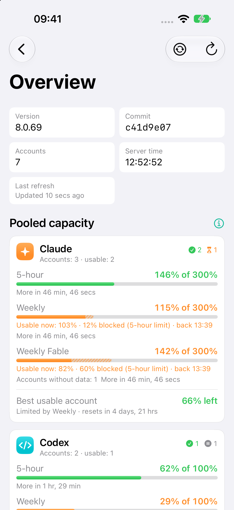
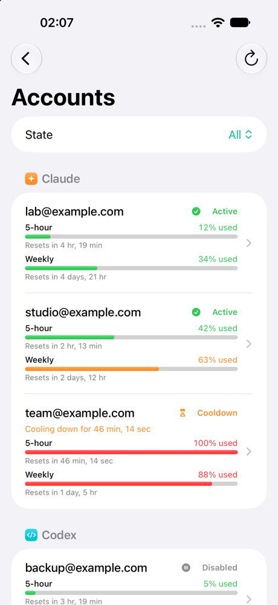
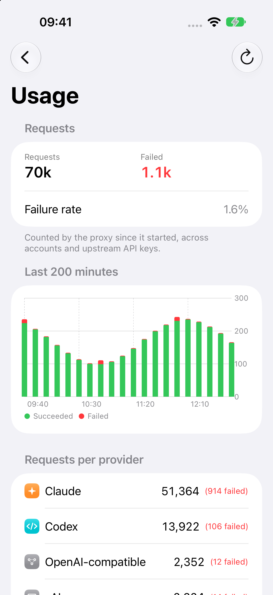

# Proxy Gauge

A native iPhone and Mac app for [CLIProxyAPI](https://github.com/router-for-me/CLIProxyAPI) servers. See how much quota your Claude, Codex and other accounts have left, which accounts are cooling down, and how much traffic the proxy has served, from your phone.

There are several macOS menu-bar apps for CLIProxyAPI. Proxy Gauge exists because there was nothing for the iPhone; the Mac app comes from the same code.

## Screenshots

Built-in demo server, iPhone:

<p>
  
  
  
  
  
</p>

## Status

Early release. Build it from source (see [Building](#building)); TestFlight and App Store builds are in preparation.

## Features

- **Several servers**, each with a name, address and either a management key or a client key. The app checks a server when you save it and shows what it found: version, accounts or models, and which optional endpoints answer.
- **Built-in demo server** with realistic sample data, clearly labelled, so you can try the app without a proxy.
- **Management key mode**
  - Overview: server version, accounts per provider and state, headroom per provider, last refresh.
  - Accounts: state (active, cooldown, disabled, error), 5-hour and weekly quota bars with reset countdowns, cooldown details, recent request chart, enable/disable and reset cooldown (each with a confirmation).
  - Usage: request totals, failures, a chart of the last 200 minutes, requests per provider, and token totals per model when the server keeps a client-key usage report.
  - Models available across your accounts.
  - Server settings: routing strategy (read and change, protected against concurrent config edits; when the server reports no config version, the app asks once more before an unconditional write), and the number of configured client keys on servers that publish client-key policies. Key values are never read or shown.
- **Client key mode**: the models the key may call, and per-credential quota bars, summary and exclusions on servers that offer `/v1/fleet/limits`. Stock CLIProxyAPI does not have that endpoint; the app says so plainly.
- **Pull to refresh** and auto refresh of the visible screen while the app is open (default 60 s, configurable). When the server rejects the key, automatic refresh (app, menu bar and widget) pauses until you refresh by hand, a change to the server succeeds, or you save the server again ("Save anyway" after a rejected check keeps the pause on), so a wrong key never runs into the proxy's ban on repeated failed logins. Each refresh sends its management requests one after another and stops at the first rejection, so a rejected key costs one failed attempt per refresh. When the proxy has already banned this network address (for example after failed logins from another client), the app and the menu bar say so and show when the ban ends, and neither they nor the widget blame the key.
- **iPhone home-screen widget** (small and medium) with the lowest headroom per provider on your default server.
- **Mac**: a split-view window plus a menu bar item with headroom per provider.
- English and Polish.

### What "headroom" means

CLIProxyAPI records the rate-limit headers that providers send back with normal responses. Proxy Gauge turns those passive observations into quota bars. For each provider it takes, per window, the lowest usage among accounts that can currently serve requests (not disabled, not cooling down, and not waiting for a new sign-in; an account in the error state still counts when it does not need one), and shows the tightest window as the provider's headroom. Missing data is shown as unknown, never as zero.

Proxy Gauge **never asks providers for quota** and never calls endpoints that reach upstream (`/requests/api-call`, plugin quota fetches) or that consume data (the usage queue). Everything it reads is state the proxy already holds, so refreshing does not spend tokens or provider rate limits.

## Setting up your server

### Management key (full access)

Proxy Gauge uses the v8 management API. In the CLIProxyAPI `config.yaml`:

```yaml
management:
  allow-remote: true          # needed when the app is not on the same machine as the proxy
  secret-key: "a-long-random-secret"
```

Restart the proxy. The plaintext secret is hashed on startup. In the app, add a server with the proxy's address (for example `http://192.168.1.10:8317`, or an HTTPS URL with any path prefix your reverse proxy uses) and paste the same secret as the management key.

If the app reports "remote management is disabled", `allow-remote` is still `false`. After five wrong keys the proxy bans the client's IP for 30 minutes; Proxy Gauge stops automatic refresh after the first rejected key for that reason.

### Client key (read-only)

Any key from `access.api-keys` works as a client key. It shows the models that key can use. On servers that provide `GET /v1/fleet/limits` (for example the fleet fork), it also shows per-credential quota bars without needing the management key. A client key cannot change anything on the server.

### Plain HTTP, LAN and Tailscale

Plain HTTP works for local network addresses and Tailscale. The app warns you when it would send a key over plain HTTP outside a private network. See [docs/networking.md](docs/networking.md) for why the app allows HTTP connections.

## Privacy

- Keys are stored only in the Keychain on your device. They are never written to settings files, logs or analytics.
- The app talks only to the servers you add. There are no analytics, no tracking, no accounts and no third-party SDKs.
- See [docs/privacy.md](docs/privacy.md).

## Building

Requirements: Xcode 26 or later, [XcodeGen](https://github.com/yonaskolb/XcodeGen) and [Bun](https://bun.sh).

```sh
make test        # Swift package tests + string catalog check
make generate    # writes Apple/ProxyGauge.xcodeproj (not committed)
make build-ios   # ad-hoc signed iOS Simulator build (Keychain and app group work), then checks extracted strings
make build-mac   # unsigned macOS build, then checks extracted strings
make integration CPA_BIN=/path/to/cli-proxy-api  # runs the client against a throwaway local CLIProxyAPI
```

The portable logic lives in the Swift package at the repository root:

- `ProxyGaugeCore` (Foundation only): API models and decoding, the HTTP client over an injectable transport, quota math and the demo server.
- `ProxyGaugeStore`: Keychain and App Group storage.
- `ProxyGaugeSession`: the per-server session the app screens observe. Refreshes and changes to the server run one at a time through one queue, so an older response never overwrites newer data or a newer key result.

The app targets live in `Apple/`: `Shared` (app screens for iPhone and Mac), `SharedUI` (views shared with the widget, plus the string catalog), `iOS`, `macOS` and `Widgets`. The app name, bundle identifier and team are set only in `Apple/Config/Identity.xcconfig`.

After changing UI strings, build both apps and run `make strings` to sync `Apple/SharedUI/Localizable.xcstrings`, then add the Polish translations. `make test` fails while any catalog entry lacks English or Polish or is stale. `make build-ios` and `make build-mac` then compare every string the Swift compiler extracted during that build (its `.stringsdata` output, the same input Xcode uses to fill the catalog) with the catalog, and fail on any key that is missing, so a new UI string cannot ship untranslated.

Uploading to TestFlight is never automatic: `make testflight CONFIRM=<bundle id>` requires the bundle identifier from the caller, runs `make test`, `make build-ios` and `make build-mac` first (so the extracted-strings check gates every upload) and uploads only the packages built in that run.

The API contract the app relies on is documented in [docs/api.md](docs/api.md), with captured responses in `docs/fixtures`.

## License

MIT, see [LICENSE](LICENSE). Proxy Gauge is an independent project and is not affiliated with CLIProxyAPI or any AI provider.
